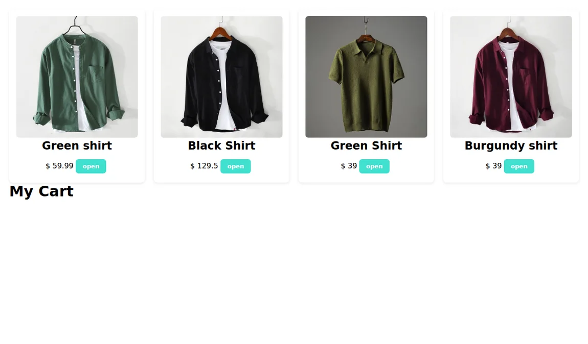

# React Storefront

A frontend practice project for browsing a local product catalog and working with a shopping cart. The demo covers quantity controls, per-product totals, and a cart total. Product data and cart state live in the frontend.

[Open the live demo](https://shooopp.netlify.app/)



## Run locally

```bash
npm ci
npm start
```

Open `http://localhost:3000`. Use `npm run build` for the static bundle.

**Stack:** React, JavaScript, and CSS. The catalog and shopping interactions are in [`src/App.js`](src/App.js). Checkout is a UI interaction in this demo.
